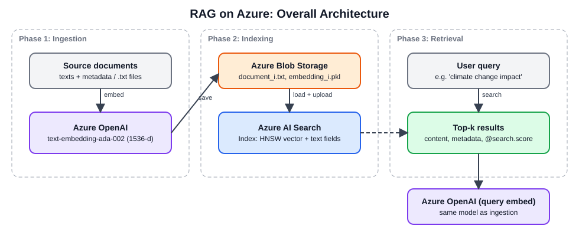
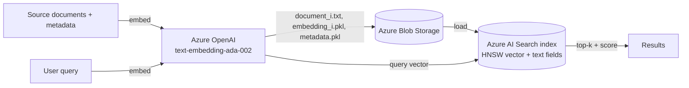
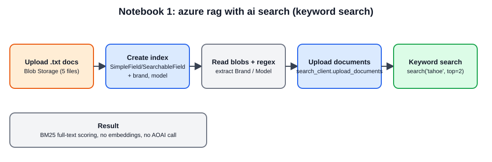
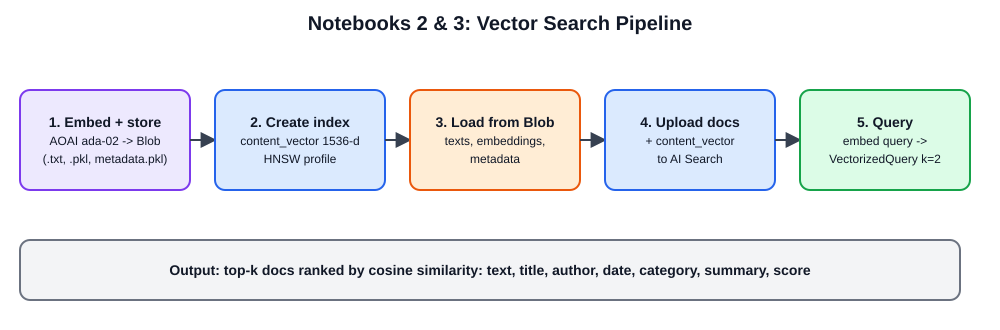
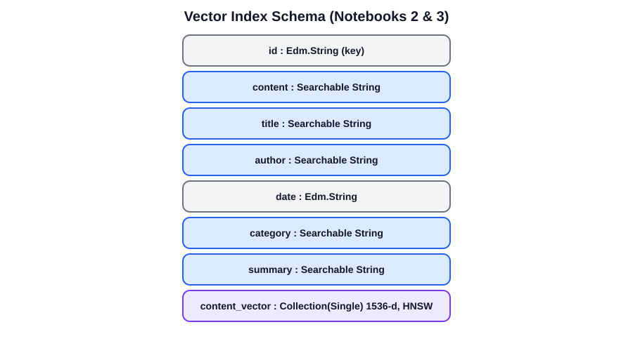

# RAG with Azure OpenAI + Azure AI Search

Hands-on Jupyter notebooks showing the **retrieval** half of Retrieval-Augmented Generation (RAG) on Azure: documents are stored in Blob Storage, indexed in Azure AI Search, and retrieved either by **keyword (BM25)** or by **vector similarity** using Azure OpenAI embeddings.

> Credentials in the notebooks are placeholders (`XXXX`). Never commit real keys. Use environment variables or Azure Key Vault.

## Contents

| File | Purpose |
|---|---|
| `azure rag with ai search.ipynb` | Notebook 1: keyword (full-text) search |
| `azure rag with ai search embedding.ipynb` | Notebook 2: embeddings + vector search |
| `azure rag with ai search embedding with vector field.ipynb` | Notebook 3: cleaned-up version of Notebook 2 |
| `images/` | Architecture and flow diagrams (SVG) |

## 1. Overall architecture





Azure services used:

- **Azure Blob Storage**: durable store for raw text, pickled embeddings and metadata.
- **Azure OpenAI**: embedding model deployment (`demo-wrmg-txt-ada-02`, 1536 dimensions).
- **Azure AI Search**: index plus keyword and vector retrieval.

Python packages: `openai`, `azure-storage-blob`, `azure-search-documents==11.4.0`, `numpy`, `pickle` (stdlib). `faiss` is imported in Notebooks 1 and 2 but never used.

---

## 2. Notebook 1: `azure rag with ai search.ipynb` (keyword search)



No embeddings and no Azure OpenAI calls. Retrieval is classic BM25 full-text search.

| Cell | What it does |
|---|---|
| 0 | Imports (`openai`, `BlobServiceClient`, `pickle`, `faiss`, `numpy`, `os`). |
| 1 | Connects to Blob Storage and uploads 5 `.txt` files (`ai_impact`, `climate_change`, `space_exploration`, `quantum_computing`, `sustainable_energy`). Each has a `Brand:… Model:…` tag appended to the text. |
| 2 | Creates the search index. Fields: `id` (key), `content`, `title`, `author`, `date`, `category`, `summary`, `brand`, `model`. |
| 3 | `get_brand_model()` extracts Brand and Model with regexes. `index_documents()` reads each blob, builds a document (title, author and so on are hard-coded placeholders) and uploads it with `upload_documents`. |
| 4 | `search(query_text, top_k=2)` runs `search_client.search()`. Example query: `"tahoe"`. It prints content, metadata and `@search.score`. |
| 5-8 | Empty cells. |

**Known issue:** the Model regex `[A-Za-z0-9]+` stops at the first space. `Model:DXL TR21` is therefore indexed as `DXL`, and `Model:RX 23` as `RX`.

---

## 3. Notebook 2: `azure rag with ai search embedding.ipynb` (vector search)



| Cell | Step | What it does |
|---|---|---|
| 0 | Imports | Includes the unused `faiss` import. |
| 1 | **Step 1: embed and store** | Defines 5 sample `texts` with `metadata` (title, author, date, category, summary). Creates an `AzureOpenAI` client (api_version `2023-09-01-preview`). `generate_embeddings()` calls `client.embeddings.create`. `upload_to_blob()` saves `document_{i}.txt`, `embedding_{i}.pkl` (pickled vector) and `metadata.pkl`. |
| 2 | Notes | `pip install azure-search-documents==11.4.0`, plus a StackOverflow reference for the v11.4.0 vector API. |
| 3 | **Step 2: vector index** | `create_vector_search_index()` builds the schema (below) with an HNSW algorithm config and the profile `my-vector-config`. |
| 4 | **Step 3: index** | `load_index_from_blob()` reads texts, embeddings and metadata back from Blob. `index_documents_with_embeddings()` merges them into documents with `content_vector` and uploads. |
| 5 | Notes | StackOverflow reference. |
| 6 | **Step 4: query** | `generate_query_embedding()` embeds the query. `perform_search()` runs a `VectorizedQuery(k_nearest_neighbors=2, fields="content_vector")` with `search_text=""`. It returns text, metadata and score. The import is inside the function, and old commented-out attempts remain. |

### Vector index schema



- `vector_search_dimensions=1536` must match the embedding model's output.
- `HnswAlgorithmConfiguration` gives approximate nearest-neighbour search.
- Search is **pure vector**: `search_text=""`, so there is no hybrid keyword blend.

---

## 4. Notebook 3: `azure rag with ai search embedding with vector field.ipynb`

Functionally the same pipeline as Notebook 2, cleaned up. Differences:

| Area | Notebook 2 | Notebook 3 |
|---|---|---|
| `faiss` import | Active (unused) | Commented out, so no faiss install needed |
| `VectorizedQuery` import | Inside `perform_search` | Top-level import |
| Commented-out old attempts | Present | Removed |
| `if __name__ == "__main__"` demo cell | In the same cell as the search function | Separate cell 7 that runs `"climate change impact"` and prints text, title, author, date, category, summary and score |
| Placeholders | Real container name `test-asif-container` left in | All placeholders |

Cell count: Notebook 2 has 7 cells, Notebook 3 has 8 (the extra one is the demo cell).

---

## 5. Comparison

| | Notebook 1 | Notebooks 2 / 3 |
|---|---|---|
| Retrieval type | Keyword (BM25) | Vector (HNSW, semantic) |
| Uses Azure OpenAI | No | Yes (embeddings) |
| Uses Blob Storage | Raw docs only | Docs, embeddings, metadata |
| Index vector field | None | `content_vector` (1536-d) |
| Matches "climate change impact" to related text | Only on shared terms | Yes, by meaning |
| Extra fields | `brand`, `model` | None |

## 6. How to run

1. Create Azure Blob Storage, Azure OpenAI (an embeddings deployment) and Azure AI Search resources.
2. Install dependencies:
   ```powershell
   pip install openai "azure-search-documents==11.4.0" azure-storage-blob numpy
   ```
3. Replace the `XXXX` placeholders (storage account and key, container, OpenAI endpoint, key and deployment name, search service name, admin key and index name).
4. Run cells top to bottom. Create the index **once**, because re-running `create_index` on an existing name fails.

## 7. Limitations and next steps

- **No generation step yet.** The notebooks retrieve only. A full RAG loop would pass the top-k text to a chat model (for example GPT-4o on Azure OpenAI) as context.
- Secrets are hard-coded. Use `os.environ` or Key Vault, and managed identity where possible.
- `pickle` for embeddings is unsafe for untrusted data. Prefer JSON, or index vectors directly.
- `api_version="2023-09-01-preview"` is old, so consider updating it.
- Documents are not chunked. Real data needs chunking (for example 500-1000 tokens with overlap).
- Consider hybrid search (`search_text` plus vector) and semantic ranking for better relevance.
- Notebook 2 duplicates Notebook 3. One can be retired.
